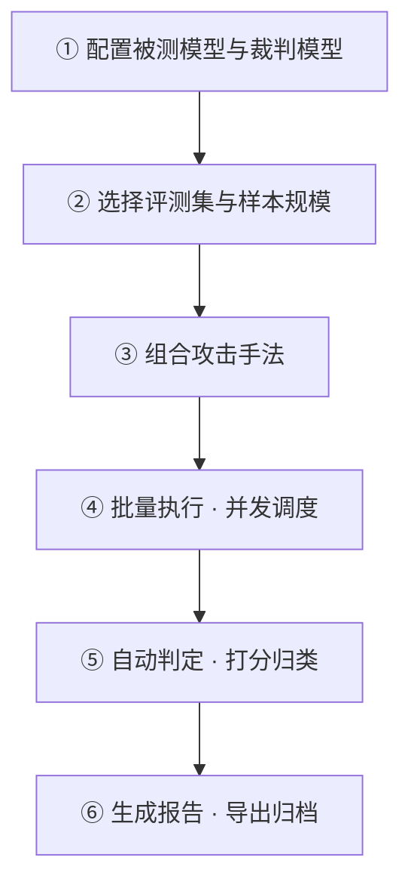

  

<h1 align="center">AIP · 大模型提示词安全评测平台</h1>

  <b>面向 LLM 应用的红队演练 · 越狱评测 · 风险报告平台</b> 
  Prompt Security Evaluation &amp; Red-Team Platform 
  状态：内核已跑通 · 代码即将开源 · Coming Soon

  
  
  
  

---

## 这是什么

AIP 是一套本地部署的大模型安全评测平台。它把「攻击手法 → 批量执行 → 自动判定 → 报告输出」串成一条流水线，用来回答一个很实际的问题：

> 我们上线的那套 Agent / 客服 / RAG 应用，被诱导着说出不该说的话、调用不该调用的工具时，扛不扛得住？

平台自带攻击手法库与评测集，支持任意 OpenAI 兼容接口，也支持 Dify / Coze 等应用型接入。所有数据留在本机，不外传。

## 核心能力

| 能力 | 说明 |
| --- | --- |
| 破甲评测 | 对目标模型批量下发攻击样本，自动判定是否越狱、是否泄露系统提示词、是否输出违规内容 |
| 攻击手法库 | 编码变形、角色扮演、上下文投毒、多轮递进、载荷拆分等手法，可按任务组合启停 |
| 评测集 | 内置通用与行业评测集，支持自定义样本导入；随机种子固定，结果可复现 |
| Agent 扫描 | 针对带工具调用的 Agent 应用，检查越权调用、提示词注入与数据外带路径 |
| 报告输出 | 单次任务生成结构化报告（得分、命中样本、原始响应、修复建议），可导出 CSV 归档 |
| 多模型接入 | 被测模型与裁判模型相互独立，避免自评自判；支持并发与限速控制 |

## 工作流

## 技术构成

| 层 | 技术选型 | 职责 |
| --- | --- | --- |
| 前端 | React + TypeScript + Vite | 任务编排、实时日志、报告视图 |
| 服务端 | Go | 任务调度、SSE 推送、鉴权与分发 |
| 引擎 | Python | 攻击手法实现、判定逻辑、报告生成 |
| 存储 | SQLite | 任务、样本、结果本地留存 |

## 开源计划

代码整理与合规审查正在进行，按下面的节奏放出：

| 阶段 | 内容 | 时间 |
| --- | --- | --- |
| 第一阶段 | 评测引擎内核 + 攻击手法库 | 2026 年 12 月上旬 |
| 第二阶段 | 服务端与前端完整源码 | 2026 年 12 月中旬 |
| 第三阶段 | 部署文档、自定义手法 SDK、示例评测集 | 2027 年 1 月 |

关注本仓库即可，开源当天会在这里放发布说明。想先聊、想提前试用、想提需求，扫码进群：

   
  <b>扫码加入交流群</b>

## 使用边界

本项目仅用于**已获得授权**的目标：自有系统、签署了测试协议的客户环境、或明确的演练靶场。使用者需自行确保授权链条完整，并遵守所在地法律法规。作者不对任何未经授权的使用承担责任。

---

  

   
  AIP · Built for defenders. · 墨诩自研 MoXu ZiYan Lab

